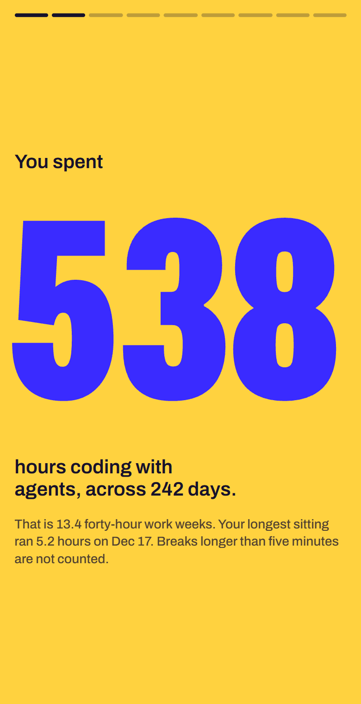
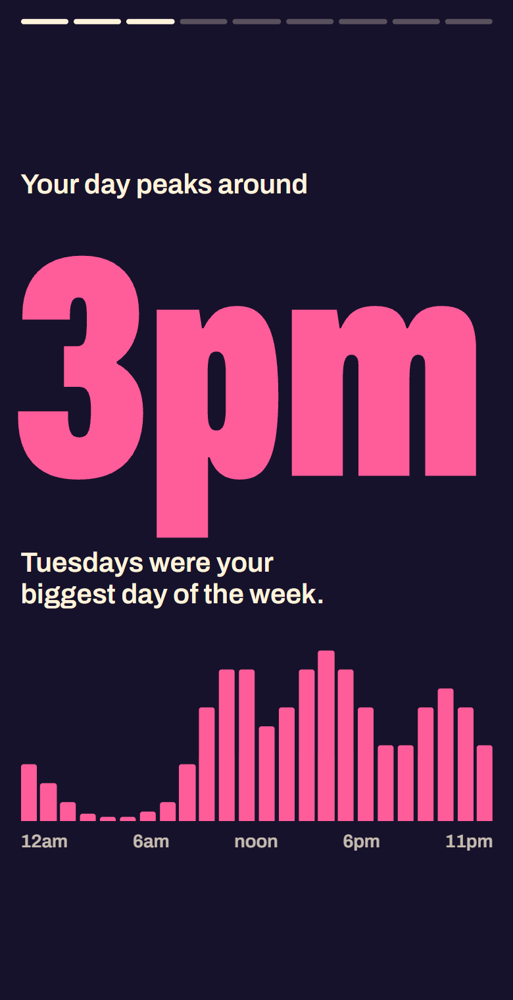
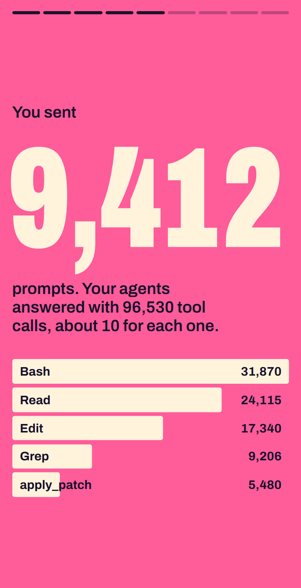
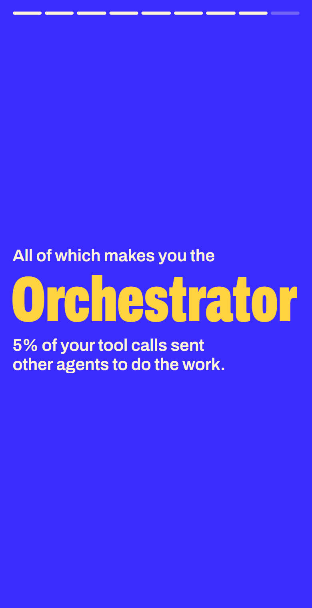
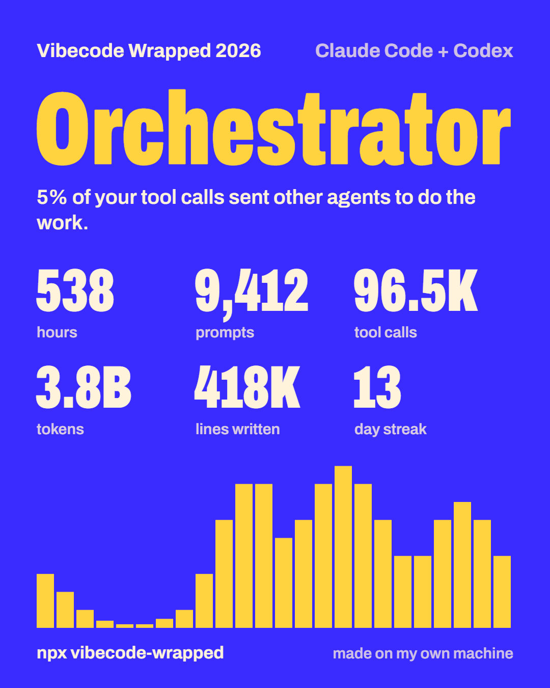

# vibecode-wrapped

**English** · [Türkçe](README.tr.md)

Your year with AI coding agents, wrapped. One command reads the Claude Code and Codex logs already on your computer and turns them into a set of cards and a shareable image.

```bash
npx vibecode-wrapped
```

<p>
  
  
  
  
</p>

The screenshots use sample data. Run `npx vibecode-wrapped --demo` to see the same cards without any logs.

## What you get

- Hours of real work, with breaks longer than five minutes left out
- The hour and weekday you code most, plus a calendar of active days and your longest streak
- Prompts sent, tool calls made, and your most used tools
- Tokens used, the models behind them, and a rough cost at API list prices
- Lines written and deleted, by file type
- A persona picked from your habits: Night Owl, Early Bird, Weekend Warrior, Marathoner, Streaker, Orchestrator, Terminal Native, Refactorer or Builder
- A 1080×1350 image to download, copy or post
- English and Turkish, picked from your system language, with a switch on every card



## Privacy

Everything runs on your machine.

- The tool makes no network requests. The page is served from `127.0.0.1` and the font is bundled.
- It has no runtime dependencies, so there is nothing else to trust.
- It reads numbers and names only: timestamps, token counts, tool names, model names, file extensions. Prompt and reply text is never stored or shown.
- File and project names stay hidden unless you pass `--show-names`, and they never appear on the cards or the image.

## Options

| Option | What it does |
| --- | --- |
| `--year <yyyy>` | Wrap a specific year. Defaults to the current year. |
| `--all` | Wrap everything on disk instead of one year. |
| `--demo` | Show the cards with made-up sample data. |
| `--text` | Print a text summary in the terminal instead of opening the cards. |
| `--json` | Print the stats as JSON. |
| `--lang <en\|tr>` | Language for the cards and the text. Defaults to your system language. |
| `--no-open` | Start the local page without opening a browser. |
| `--show-names` | Include file and project names in `--text` and `--json` output. |

Requires Node.js 18 or newer.

## Where the data comes from

| Agent | Location | Override |
| --- | --- | --- |
| Claude Code | `~/.claude/projects/**/*.jsonl` | `CLAUDE_CONFIG_DIR` |
| Codex | `~/.codex/sessions` and `~/.codex/archived_sessions` | `CODEX_HOME` |

The wrap covers what is still on disk. Claude Code removes old transcripts after a retention period, so to keep a full year, raise `cleanupPeriodDays` in `~/.claude/settings.json`.

## How the numbers are counted

- **Time.** A minute counts when there is activity in it. A gap longer than five minutes is a break. Sessions running side by side are counted once, and subagents add no time of their own.
- **Tokens.** Input, output, cache writes and cache reads, added up. Most of the total is cached context being re-read, which is why it gets large.
- **Cost.** Tokens multiplied by public API list prices for each model. If you are on a subscription this is not what you paid. Prices live in [`src/pricing.ts`](src/pricing.ts).
- **Lines.** Added and removed lines from the edits your agents applied.

## Development

```bash
git clone https://github.com/BerkanAtik/vibecode-wrapped
cd vibecode-wrapped
npm install
npm run build
npm test
npm start -- --demo
```

The readers are in `src/readers`, one file per agent. Adding another agent means writing one reader that feeds the same `Aggregator`. Issues and pull requests are welcome.

## License

MIT. The bundled typeface is [Archivo](https://github.com/Omnibus-Type/Archivo), under the SIL Open Font License.
