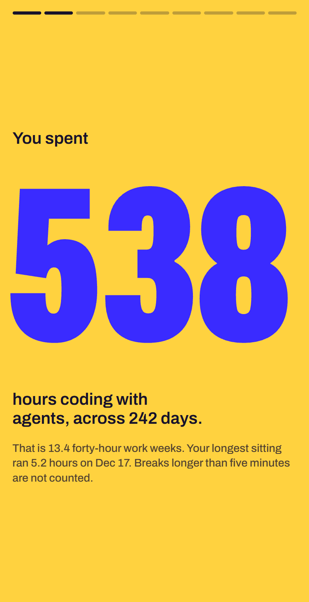
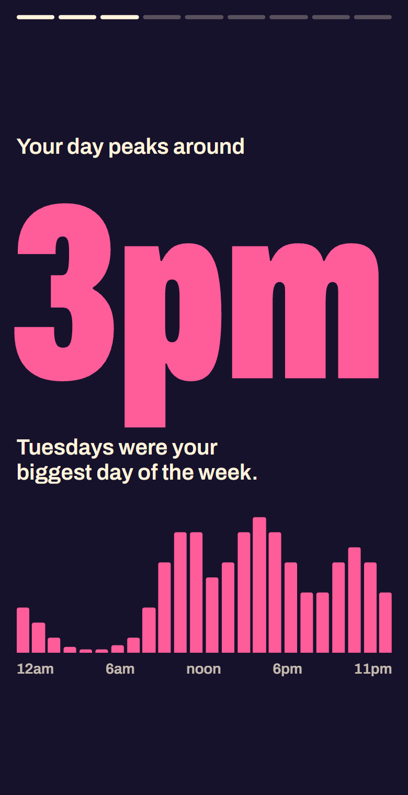
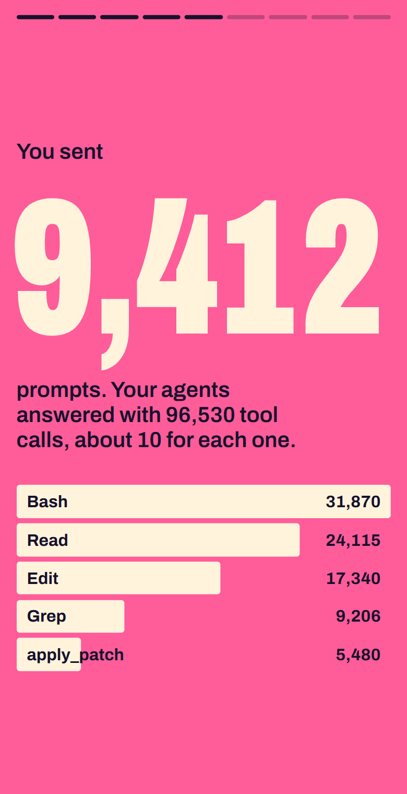
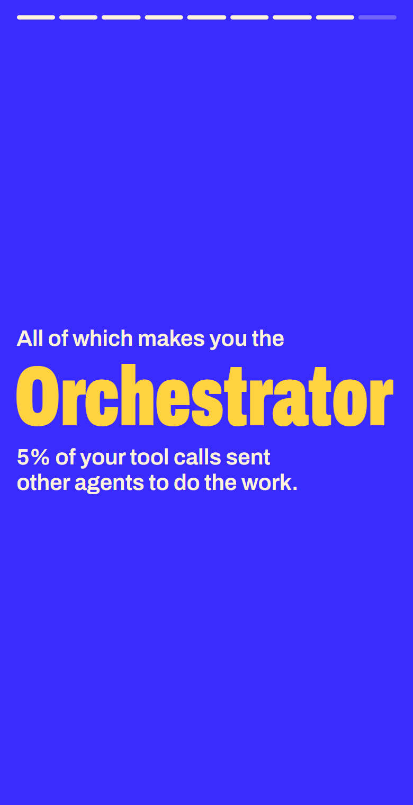
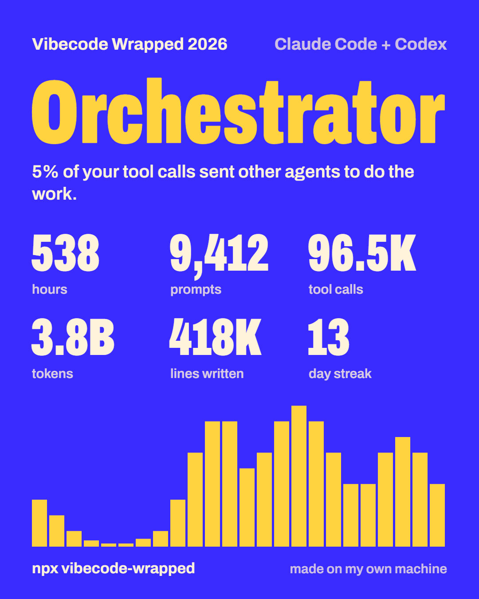

# vibecode-wrapped

[English](README.md) · **Türkçe**

Yapay zekâ kodlama ajanlarıyla geçen yılının özeti. Tek bir komut, bilgisayarındaki Claude Code ve Codex kayıtlarını okur; bunları bir dizi karta ve paylaşılabilir bir görsele dönüştürür.

```bash
npx vibecode-wrapped
```

<p>
  
  
  
  
</p>

Ekran görüntüleri örnek veriyle hazırlandı. Kayıt olmadan aynı kartları görmek için `npx vibecode-wrapped --demo` çalıştır.

## Neler var

- Gerçek çalışma saatlerin; beş dakikadan uzun molalar sayılmaz
- En çok kod yazdığın saat ve gün, aktif günlerin takvimi ve en uzun serin
- Gönderdiğin prompt'lar, yapılan araç çağrıları ve en çok kullanılan araçlar
- Harcanan token'lar, arkadaki modeller ve API liste fiyatlarıyla kabaca maliyet
- Dosya türüne göre yazılan ve silinen satırlar
- Alışkanlıklarından seçilen bir kişilik: Gece Kuşu, Erkenci Kuş, Hafta Sonu Savaşçısı, Maratoncu, Seri Ustası, Orkestra Şefi, Terminal Kurdu, Refactor Ustası ya da İnşaatçı
- İndirebileceğin, kopyalayabileceğin ya da paylaşabileceğin 1080×1350 bir görsel
- Türkçe ve İngilizce: dil, sistem dilinden seçilir ve her kartta değiştirilebilir



## Gizlilik

Her şey bilgisayarında çalışır.

- Araç hiçbir ağ isteği yapmaz. Sayfa `127.0.0.1` üzerinden sunulur ve font pakete dahildir.
- Çalışırken başka hiçbir pakete ihtiyaç duymaz, yani güvenmen gereken başka bir şey yok.
- Yalnız sayılar ve adlar okunur: zaman damgaları, token sayıları, araç adları, model adları, dosya uzantıları. Prompt ve yanıt metinleri hiçbir zaman saklanmaz ya da gösterilmez.
- Dosya ve proje adları `--show-names` vermedikçe gizli kalır; kartlarda ve görselde hiçbir zaman görünmez.

## Seçenekler

| Seçenek | Ne yapar |
| --- | --- |
| `--year <yyyy>` | Belirli bir yılı özetler. Varsayılan: bu yıl. |
| `--all` | Tek bir yıl yerine diskteki her şeyi özetler. |
| `--demo` | Kartları uydurma örnek veriyle gösterir. |
| `--text` | Kartları açmak yerine terminalde yazılı özet verir. |
| `--json` | İstatistikleri JSON olarak yazdırır. |
| `--lang <en\|tr>` | Kartların ve yazıların dili. Varsayılan: sistem dilin. |
| `--no-open` | Yerel sayfayı tarayıcı açmadan başlatır. |
| `--show-names` | `--text` ve `--json` çıktısına dosya ve proje adlarını ekler. |

Node.js 18 ya da daha yenisi gerekir.

## Veriler nereden geliyor

| Ajan | Konum | Değiştirmek için |
| --- | --- | --- |
| Claude Code | `~/.claude/projects/**/*.jsonl` | `CLAUDE_CONFIG_DIR` |
| Codex | `~/.codex/sessions` ve `~/.codex/archived_sessions` | `CODEX_HOME` |

Özet, diskte hâlâ duran kayıtları kapsar. Claude Code eski kayıtları bir süre sonra siler; yılın tamamını saklamak için `~/.claude/settings.json` içindeki `cleanupPeriodDays` değerini yükselt.

## Sayılar nasıl hesaplanıyor

- **Süre.** İçinde etkinlik olan her dakika sayılır. Beş dakikadan uzun boşluk moladır. Yan yana çalışan oturumlar bir kez sayılır; alt ajanlar ayrıca süre eklemez.
- **Token.** Giriş, çıkış, önbelleğe yazma ve önbellekten okuma toplamı. Toplamın çoğu, tekrar tekrar okunan önbellekteki bağlamdır; sayının büyük olmasının sebebi bu.
- **Maliyet.** Token'lar, her modelin herkese açık API liste fiyatıyla çarpılır. Abonelik kullanıyorsan ödediğin tutar bu değildir. Fiyatlar [`src/pricing.ts`](src/pricing.ts) dosyasında.
- **Satırlar.** Ajanlarının uyguladığı düzenlemelerdeki eklenen ve silinen satırlar.

## Geliştirme

```bash
git clone https://github.com/BerkanAtik/vibecode-wrapped
cd vibecode-wrapped
npm install
npm run build
npm test
npm start -- --demo
```

Okuyucular `src/readers` klasöründe, her ajan için bir dosya. Yeni bir ajan eklemek, aynı `Aggregator`'ı besleyen bir okuyucu yazmak demek. Issue ve pull request'lere açığız.

## Lisans

MIT. Pakete dahil yazı tipi [Archivo](https://github.com/Omnibus-Type/Archivo), SIL Open Font License ile lisanslıdır.
